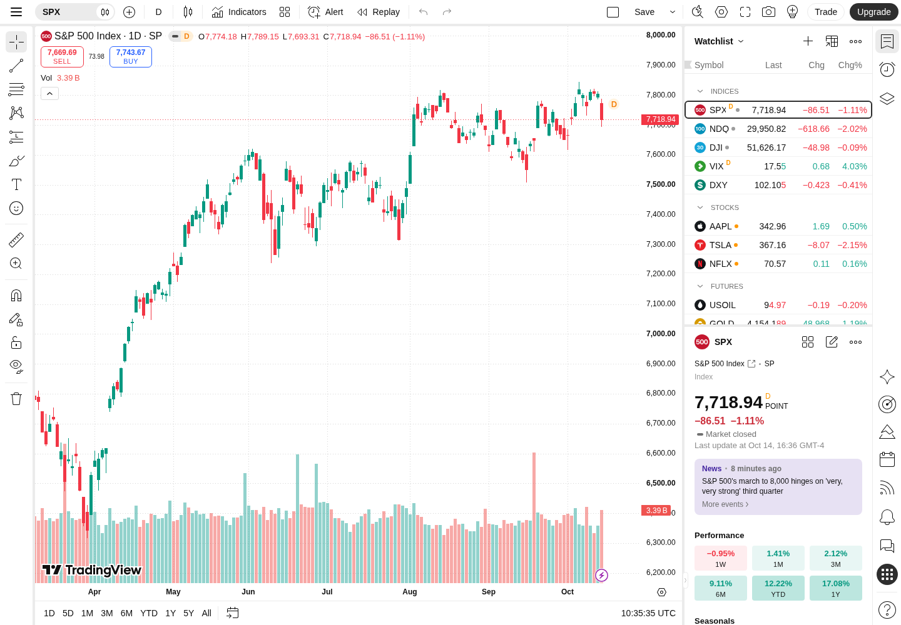

# TradingView Supercharts local replication analysis

The inspected application is TradingView Supercharts at **https://www.tradingview.com/chart/?symbol=SP%3ASPX**. A useful local equivalent can reproduce its chart workspace, instrument search, watchlists, indicators, drawings, layouts, replay, and paper simulation. The strongest starting point for a personal localhost application is **Lightweight Charts with a custom TypeScript application and local data service**. The large implementation work is the surrounding behavior, financial data semantics, and persistence.

This package contains live interface evidence and a proposed reconstruction specification. It does **not** recover TradingView's original source or establish complete behavioral equivalence. **Updated 16 October 2026:** the [authenticated findings](AUTHENTICATED-FINDINGS.md) establish working drawings, RSI, save/reload, synchronized layouts, replay, Pine compilation, and strategy reports. Alert forms and paper order-entry surfaces were inspected without creating alerts or submitting orders. Numerical parity, full Pine compatibility, order execution, and advanced interactions remain open.

Read [LOCAL-IMPLEMENTATION.md](LOCAL-IMPLEMENTATION.md) for the proposed architecture, data contracts, indicator mathematics, simulation rules, storage, and release criteria. Open [index.html](index.html) for a navigable report and screenshot gallery. The [evidence index](evidence/index.json) maps every short reference such as E01 to its full REA Evidence ID, declared actions, outcomes, and extracted artifacts.

## Inspection scope and evidence

The original baseline used REA controlled browser scenarios on 15 October 2026, with Chromium 153.0.8010.12, isolated temporary profiles, no account, locale en-US, and device scale factor 1. Desktop captures used 1440 × 1000; the narrow viewport used 390 × 844. The first scenario used America/New_York browser timezone; subsequent scenarios used UTC. These are test-environment settings, distinct from the instrument's exchange timezone. REA reported terminating all browsers it owned. The 16 October authenticated investigation instead attached to an external browser and created a separate inspection layout. Its environment, 35 scenarios, 290 steps, 27 additional screenshots, limitations, and A-series evidence are documented in [AUTHENTICATED-FINDINGS.md](AUTHENTICATED-FINDINGS.md).

There are **18 retained scenario records, 160 recorded steps, and 32 selected screenshots**. Of the steps, 133 completed, 7 failed, and 20 were cancelled after a failure; scenario-start navigation is included in these counts. Failed locators and intercepted clicks are retained, and are not treated as successful feature tests. Later focused captures resolved several locator problems and established registration gates. These counts measure inspection activity, not product test coverage.

| Reference | Question and useful result | Boundary |
| --- | --- | --- |
| E01 | Default SPX workspace, DOM/canvas structure, startup HTTP and WebSocket traffic | Event budget reached; one dropped event; one HTTP request unfinished |
| E02 | Symbol search, interval menu, chart-style inventory | Menu inventory, not every option exercised |
| E03 | Indicator directory and trend-tool inventory | Settings click failed because several controls shared its label |
| E04 | Layout menu and synchronization options | Earlier Settings dialog remained open; later replay action intercepted |
| E05 | Alert, replay, and save entry points | All reached registration prompts |
| E06 | Object tree and Pine editor | Editor opened; later Trade click intercepted by editor overlay |
| E07 | Settings Symbol/Canvas tabs and broker chooser | Correctly scoped Settings selector; no broker connected |
| E08 | Daily → hourly chart transition and undo label | Subsequent style selector failed; event budget reached |
| E09 | Candles → Line transition and undo label | No numerical rendering comparison |
| E10 | Six drawing-category menus and magnet choices | Selection/placement mechanics generally untested |
| E11–E12 | RSI search results | Text locators did not match; no indicator was added |
| E13 | Select Horizontal line, then attempt placement | Registration overlay intercepted canvas click; no drawing created |
| E14 | Search RSI and inspect result DOM | Identified built-in `data-id="STD;RSI"` |
| E15 | Select the built-in RSI through that stable identity | Registration prompt; no RSI calculation observed |
| E16 | Narrow viewport with dark system preference | Light UI remained; this was desktop Chromium at narrow width, not mobile emulation |
| E17 | Main menu, snapshot menu, data window | Snapshot actions listed; download/clipboard/share not exercised |
| E18 | Search NASDAQ:AAPL, select with Enter, toggle dark theme | Symbol/chart/details changed; URL retained original SPX query; reload persistence untested |

The following baseline sections retain their dated E-series observations. Later A-series findings supersede the account-gated coverage conclusions, as noted beside the relevant features and in the final coverage table. **Observed** means present in a captured state or message; **inferred** describes a bounded interpretation; **proposed** describes the local replacement. Static asset names alone do not establish source architecture or execution.

## Workspace layout and visual specification



At 1440 × 1000, the interface is a dense workspace with a header, left drawing rail, central chart, right watchlist/details column, right navigation rail, and bottom range/time strip. The chart occupies most of the viewport and does not sit inside a conventional scrolling document. The right details area has substantially more content than fits on screen. [E01]

| Region | Observed desktop geometry | Local replication requirement |
| --- | --- | --- |
| Header | Approximately 40 px high | Compact icon/text commands; separators; overflow behavior |
| Left drawing rail | Approximately 52 px wide, followed by a narrow separator | Persistent tool groups, active tool, tooltips, hide/lock/magnet states |
| Main chart | Starts near x=55; column ends near x=1091 | Resize continuously when panels change; maintain financial anchors |
| Main plot canvases | DOM dimensions 968 × 891 at DPR 1 | Layered plot and interaction surface; these are pane dimensions, not the full chart column |
| Price scale | DOM dimensions 66 × 891 | Independent scale rendering, current-price labels, scale interactions |
| Time scale | DOM dimensions 968 × 28 | Session-aware tick labels; current crosshair time |
| Watchlist/details | Roughly 300 px wide | Watchlist above independently browsable details; adjustable division is a proposed feature until tested |
| Right rail | Roughly 45 px wide | Panel toggles with active state |
| Bottom strip | Roughly 38 px high | Range presets and timezone; narrower layout collapses presets |

Dimensions other than the explicitly stated DOM canvas sizes are visual estimates from E01. The full DOM contained 19 canvas elements, including detail widgets; that count is not a required renderer architecture.

Raster sampling of E01 and E18 yields these useful starting tokens:

| Token | Light observation | Dark observation |
| --- | --- | --- |
| Main surface | `#ffffff` | `#0f0f0f` |
| Raised menu surface | Light surface | `#1f1f1f` |
| Separators | `#ebebeb` | `#2e2e2e` |
| Rising candle | `#089981` | `#089981` |
| Falling candle | `#f23645` | `#f23645` |
| Volume appearance | Pale teal/red | Muted dark teal/red |

These are sampled pixels, not recovered CSS variables. Typography appears to use compact sans-serif UI text and tabular-looking numerical alignment; exact computed font family, weight, spacing, and all hover/focus tokens were not captured. Start with 12–14 px controls and refine against the screenshot references. Use original app naming/assets for a local derivative except for attribution required by chosen dependencies.

At 390 × 844, the watchlist and right rail are absent, the chart legend becomes more compact, the left tool rail remains, and the range presets become a **Date Range** menu. The top toolbar extends beyond the visible width. Dark OS preference did not automatically change the captured light theme. An explicit main-menu Dark theme toggle did change the desktop chart, scales, menus, and details to dark. Full touch behavior and breakpoints between these two widths remain untested. [E16, E18]

## Functional inventory

### Chart and top toolbar

The top toolbar exposes symbol selection, data-type switching, comparisons, interval, chart style, indicators, indicator templates, alert creation, replay, undo/redo, layout setup, save/manage layouts, quick search, settings, fullscreen, snapshot, community publishing, Trade, and Upgrade. Controls carry accessible labels even when represented by icons. Undo was initially disabled; changing interval, chart style, and symbol produced specific undo labels. Drawing undo/redo was subsequently exercised successfully in the authenticated session. [E01, E08, E09, E18; A08]

The chart legend contains instrument name, resolution, source, market/delay state, OHLC, absolute/percentage change, and Volume. Volume has hide/settings/remove/more controls. Bid/ask-like Sell and Buy boxes also appear on SPX, even though quote metadata marks the index nontradable. A local order action must use instrument capabilities rather than assuming these boxes establish tradability. [E01]

The observed chart-style menu lists:

| Family | Observed entries |
| --- | --- |
| OHLC | Bars, Candles, Hollow candles, Volume candles |
| Lines | Line, Line with markers, Step line |
| Areas | Area, HLC area, Baseline |
| Other conventional | Columns, High-low |
| Order-flow/profile | Volume footprint, Time price opportunity, Session volume profile |
| Transformed/non-time | Heikin Ashi, Renko, Line break, Kagi, Point & figure, Range |

Entries expose favorite actions and help affordances. **Only Candles → Line was exercised.** Seeing a menu item does not establish that the anonymous session can use it, that the current instrument supports it, or that its required data is available. Order-flow charts cannot be reconstructed accurately from daily OHLC alone. [E02, E09]

### Symbol identity and search

The Symbol search dialog accepts a symbol, ISIN, or CUSIP; supports spread operators; and has All, Stocks, Funds, Futures, Forex, Crypto, Indices, Bonds, Economy, and Options tabs. Results distinguish exchange/provider and instrument type, with expandable groups. Searching SPX returns the SP index, CFDs, a London-listed stock, and unrelated crypto instruments. A ticker string alone is therefore insufficient as a database key. [E02]

Searching `NASDAQ:AAPL` and pressing Enter selected Apple, changed the chart header and quote/details content, highlighted its watchlist row, and exposed a dividend-adjustment control. The undo label became **Undo change symbol**. In this scenario the URL still contained `symbol=SP%3ASPX`. Treat initial deep-link selection and ongoing workspace state as distinct concerns; choose URL synchronization deliberately for the replacement. [E18]

### Intervals and visible ranges

The interval menu groups ticks, seconds, minutes, hours, days, and ranges. It includes custom intervals and favorites. Observed entries are:

| Group | Values |
| --- | --- |
| Ticks | 1, 10, 100, 1000; disabled for this captured SPX state |
| Seconds | 1, 5, 10, 15, 30, 45 |
| Minutes | 1, 2, 3, 5, 10, 15, 30, 45 |
| Hours | 1, 2, 3, 4 |
| Days and above | 1 day, 1 week, 1 month, 3 months, 6 months, 12 months |
| Ranges | 1, 10, 100, 1000 |

Selecting one hour changed the interval labels and OHLC/volume legend and enabled **Undo change resolution**. Bar alignment, resampling rules, and numerical equivalence were not exhaustively tested. [E02, E08]

The bottom presets explicitly couple range and resolution: 1D → 1-minute intervals; 5D → 5-minute; 1M → 30-minute; 3M → 1-hour; 6M → 2-hour; YTD and 1Y → daily; 5Y → weekly; All → monthly. This mapping was read from accessible labels, not exercised for every preset. Replicating these as viewport zoom buttons alone would miss part of the specified behavior. Go to and Timezone are separate commands. [E01]

### Indicators and scripting

The indicator directory contains personal scripts, purchased scripts, built-in technicals/fundamentals, community/editor selections, trending content, and marketplace navigation. Tabs include Indicators, Strategies, Profiles, Patterns, and Options. Search results mix built-ins and community scripts, with author names and access indicators. Built-in RSI is distinguishable by `STD;RSI`, not merely its title. [E03, E14]

In the anonymous baseline, selecting that built-in RSI displayed a registration prompt. Authenticated inspection later added its pane, inspected Inputs/Style/Visibility, observed RSI 51.94 and RSI-based MA 55.09, and verified save/reload. Independent formula equivalence remains open. The default Volume series was already present. [E01, E15; A05–A08]

The Pine command opens an editor overlay with an untitled v6 starter indicator, source textbox, save/publish actions, position status, documentation link, and a move-to-split-view command. Authenticated inspection subsequently compiled an authored SMA indicator and mechanics strategy, observed a compiler diagnostic, generated a strategy report, and inspected trades/properties. Remote Pine draft/translation requests were observed. Full language compatibility, named-script persistence, publishing, and debugging remain unverified. [E06; A20–A24]

### Drawings and object management

The left rail includes cursors, trend tools, Fibonacci/Gann, patterns, forecasting/measurement, brushes/shapes, annotations, icons, measure, zoom, magnets, keep drawing, locking, hiding, and removal. Group buttons and current-tool buttons are distinct. [E01]

| Group | Observed tool inventory |
| --- | --- |
| Lines | Trendline, Ray, Info line, Extended line, Trend angle, Horizontal line/ray, Vertical line, Crossline |
| Channels | Parallel channel, Regression trend, Flat top/bottom, Disjoint channel |
| Pitchforks | Pitchfork, Schiff pitchfork, Modified Schiff pitchfork, Inside pitchfork |
| Fibonacci | Retracement, Trend-based extension, Channel, Time zone, Speed resistance fan/arcs, Trend-based time, Circles, Spiral, Wedge, Pitchfan |
| Gann | Box, Square fixed, Square, Fan |
| Chart patterns | XABCD, Cypher, Head and shoulders, ABCD, Triangle, Three drives |
| Elliott/cycles | Impulse, Correction, Triangle, Double combo, Triple combo, Cyclic lines, Time cycles, Sine line |
| Forecasting | Long/Short position, Position forecast, Bars pattern, Ghost feed, Sector |
| Volume-based | Anchored VWAP, Fixed range volume profile, Anchored volume profile |
| Measurement | Price range, Date range, Date and price range |
| Brushes/arrows | Brush, Highlighter, Arrow marker, Arrow, Arrow mark up/down |
| Shapes | Rectangle, Rotated rectangle, Path, Circle, Ellipse, Polyline, Triangle, Arc, Curve, Double curve |
| Annotation | Text, Note, Price note, Pin, Table, Callout, Comment, Price label, Signpost, Flag mark, Image, Post, Idea |
| Magnet | Weak magnet, Strong magnet; Snap to indicators disabled in the inspected state |

This inventory comes from E03/E10, not a claim that every tool works for anonymous users. Selecting Horizontal line triggered a registration overlay in E13. Authenticated A08–A09 later verified placement, undo/redo, coordinate editing to 7100, save/reload, and a contextual drawing alert. Dragging, snapping, locking, deletion, and the remaining tool geometries still require reference tests. [E13; A08–A09]

The Object tree/Data window panel lists the active SPX chart and Vol; includes drawing group/clone/move commands, disabled when nothing suitable is selected; and offers layout drawing management. The Data window tab shows the selected date, OHLC, change, volume, last-day change, and indicator outputs in a readable tree. Its values are a useful numerical comparison surface once the reference account and dataset are available. [E06, E17]

### Watchlists, details, and ancillary panels

The default watchlist is grouped into Indices, Stocks, Futures, Forex, and Crypto. Columns show Symbol, Last, Chg, and Chg%. Controls include watchlist selection, adding symbols, advanced view, and settings. The selected row has a distinct outline/background state. Adding/reordering/sorting/persisting entries was not exercised. [E01]

The details pane shows identity/source/type, latest value, changes, delay/session state, last-update time, news, performance horizons, seasonals, technical summary, options-related charts, and profile identifiers. AAPL changes the content to company information, corporate events, regular-session and premarket values. These panels need separate datasets and instrument capabilities; a generic OHLC API does not supply all of them. [E01, E18]

The right rail exposes Watchlist/details/news, Alerts, Object tree/data window, AI Copilot, Screeners, Pine, Calendars, Community, Notifications, Chats, Products, and Help Center. These affordances were inventoried; most deeper flows were not opened. Exact AI, screener, calendar, and social behavior remains outside the captured scope. [E01]

### Settings, layouts, exports, and trading

Settings has Symbol, Status line, Scales and lines, Canvas, Trading, Alerts, and Events tabs. Symbol settings include candle body/borders/wick colors, previous-close coloring, precision, and timezone. Canvas settings include background, grids, crosshair, watermark, scale text size, navigation/pane button visibility, and top/bottom/right margins. Template, Cancel, and Ok controls are present. Only Symbol and Canvas contents were inspected; settings commit/revert and template persistence remain untested. [E07]

Layout setup exposes arrangements from one through sixteen charts, including asymmetric grids. Sync options cover symbol, interval, crosshair, clicked time, and date range. E04 captured disabled switch semantics in one-chart mode and E05 reached registration on save. Authenticated A17–A20 instantiated two charts, activated the interval-sync row by keyboard despite its underlying switch's disabled ARIA attribute, synchronized daily → hourly, and verified saved two-chart state after reload. The other synchronization policies and larger arrangements remain untested. [E04, E05; A17–A20]

The snapshot menu offers download image, copy image, copy link, open in new tab, and tweet. No image was downloaded or published. Local image export can be implemented independently; hosted links and social publishing require additional services if desired. Observed shortcuts include Ctrl+Alt+S for download, Ctrl+Shift+S for copy image, and Alt+S for copy link. [E17]

Trade opens a broker chooser containing Paper Trading and regional brokers. Authenticated inspection connected the simulator, confirmed SPX is nontradable, and inspected EURUSD Market/Limit/Stop tickets, DOM, and account-manager structure. No order was submitted and no real broker connected. Broker selection is influenced by environment/region, so the displayed broker roster is not a universal product requirement. [E07; A25–A32]

Authenticated alerts and replay are detailed in [AUTHENTICATED-FINDINGS.md](AUTHENTICATED-FINDINGS.md): price/drawing conditions, trigger frequency, message/notification forms, historical stepping, speed choices, and exit confirmation were observed. Alert delivery, replay cadence, replay fills, and saved replay restoration remain untested. [A09–A16]

## Observed data flows and runtime boundaries

The [network summary](evidence/network-summary.json) is derived from E01 and retains event counts, endpoint paths/query names, message counts, selected SPX metadata, series-window samples, and asset URLs. Its derivation is reproducible with [extract_evidence.py](extract_evidence.py). The original [REA bundle](evidence/rea-session.json) remains the primary evidence.

### Delivery and rendering

The captured HTML references hashed JavaScript/CSS bundles on `static.tradingview.com`, localization bundles, and separate symbol-logo assets. The final DOM contained 49 external script elements and 14 inline script elements. Main price plotting, interaction overlay, price scale, and time scale use separate canvas nodes, while controls and legends are HTML. These are direct DOM observations. The original framework, exact module graph, source maps, rendering algorithms, and build configuration were not recovered. [E01]

An appropriate bounded interpretation is a web client with layered chart rendering, independently loaded feature assets, and multiple remote data services. The observations do not identify TradingView's backend languages, databases, deployment topology, or every place that indicators run.

### Market streaming

A WebSocket opened to `wss://data.tradingview.com/socket.io/websocket` with chart-related query fields. Its path name does not establish compatibility with a standard Socket.IO client. Captured messages use an application framing pattern `~m~length~m~payload` and JSON messages with `m` and `p` fields; heartbeat bodies also appear. The extraction script decoded 275 framed messages without a framing/JSON failure within the retained window. One frame can contain several messages. [E01]

Observed message families include:

| Direction | Messages | Bounded interpretation |
| --- | --- | --- |
| Client → service | `set_auth_token`, `set_locale`, `chart_create_session`, `switch_timezone` | Session initialization |
| Client → service | `resolve_symbol`, `create_series`, `modify_series` | Symbol metadata and price series requests |
| Client → service | `quote_create_session`, `quote_set_fields`, `quote_add_symbols`, `quote_remove_symbols`, `quote_fast_symbols` | Separately managed quote subscriptions |
| Client → service | `create_study`, `remove_study`, `request_studies_metadata` | Study requests, including Volume and corporate-event studies |
| Service → client | `symbol_resolved`, `series_loading`, `timescale_update`, `series_completed` | Metadata/history delivery and completion |
| Service → client | `qsd`, `quote_completed` | Incremental quote objects and completion |
| Service → client | `study_loading`, `du`, `study_completed` | Study outputs delivered by the service |

The baseline main series requested daily resolution and 300 bars. Its captured history contains 300 rows from 6 August 2025 through 14 October 2026. The last vector is:

```json
[1791984600, 7774.18, 7789.15, 7693.31, 7718.94, 3388032960]
```

Matching this vector to the chart/data-window values supports the derived interpretation **Unix seconds, open, high, low, close, volume**. The timestamp is 14 October 2026 13:30 UTC, the observed exchange session opening time that day. The display rounds volume to 3.39 B. This is evidence for these observed vectors, not a specification of every possible wire message or a complete historical database. A second series was a synthetic seasonals timeline; it must not be confused with additional SPX price history. [E01, E17]

Some studies are visibly requested over the network and returned as data. It is reasonable to infer service-side processing for those outputs, but this does not prove that every indicator or drawing calculation uses the same path.

### SPX metadata that affects correctness

| Field | Observed value | Reconstruction consequence |
| --- | --- | --- |
| Public name | `SP:SPX` | Preserve source-qualified identity |
| Resolved full name | `SP_NAUTH:SPX` | Anonymous route differs from public identity; do not expose this as a new local instrument |
| Type/exchange | `index` / `SP` | Capabilities differ from stock, futures, and CFD instruments |
| Timezone | `America/New_York` | Use exchange calendar and DST, independently of display timezone |
| Session | Literal `0930-1610` | Preserve provider-specific session metadata; do not replace it with an assumed 16:00 close |
| Price scale / min move | `100` / `1` | Display two decimals and a 0.01 increment for this captured feed |
| Delay | `600`, with `delayed_streaming_600` | Data is marked delayed; 600 seconds is the indicated delay |
| Adjustment | `none` | Avoid silently applying equity adjustment rules |
| Value unit | `POINT` | Display index points separately from any accounting currency |
| Tradability | `false` | Chart visibility does not authorize or define executable orders |
| Provider field | `ice` | A reported provider identifier, not proof of redistribution entitlement |

Holiday and session-correction metadata was also delivered. The data source supplied volume, but its methodology was not established. Do not label it as directly traded index volume without source documentation. This table describes this anonymous feed at capture time; the local provider may legitimately use a different calendar, delay, or dataset. [E01]

### HTTP and supporting services

| Observed host/path | Evidence establishes | Local replacement |
| --- | --- | --- |
| `www.tradingview.com/chart/` | Chart document route and symbol query | Local workspace route/deep link |
| `static.tradingview.com/static/bundles/…` | Hashed runtime asset requests | Bundled local JS, CSS, icons, fonts |
| `s3-symbol-logo.tradingview.com/…` | Symbol/source logo requests | Local icon assets or text badges |
| `www.tradingview.com/api/v1/study-templates` | A startup request for study templates | Versioned indicator-template storage |
| `www.tradingview.com/api/v1/brokers/trading_panel` | Broker panel request | Paper-broker configuration and optional adapters |
| `scanner.tradingview.com/symbol` | Instrument fields requested, including performance/technical metrics | Local metrics query service |
| `scanner-backend.tradingview.com/enum/ordered` | Metrics enumeration request | Local metric catalog |
| `news-mediator.tradingview.com/public/news-flow/v2/news` | News requests scoped to SPX and client context | Optional provider-backed news adapter |
| `options-charting.tradingview.com/v1/…` | Term-structure/volatility chart requests | Separate options dataset and analytics if included |
| Telemetry/analytics hosts | Reporting traffic | Not needed for localhost functionality |

E01 contains 715 retained HTTP request events, many for static assets, plus response/completion events and WebSocket traffic. This is one startup window. HTTP response bodies were not requested, so schemas and endpoint business semantics are not established merely by URLs. Symbol-search endpoints were not captured in this baseline. These are observed private application surfaces, **not a supported integration contract for the replacement**. Use a local adapter API and a separately obtained data source.

## Choosing the local foundation

| Approach | Advantage | Additional work and constraint | Fit |
| --- | --- | --- | --- |
| Lightweight Charts + custom shell | Open source renderer; direct control of local data and app behavior | Build indicators, drawings, workspace services, replay, alerts, simulator | Recommended for personal localhost app |
| Advanced Charts | Much of the chart UI, studies, and drawing toolbox already supplied | Own data/storage; proprietary availability terms; still lacks several Supercharts services | Consider only if the project is eligible |
| Trading Platform | Additional trading UI and integration interfaces | Broker/data backend and product access required | Broker/platform project |
| TradingView hosted widget | Fast visual embed with hosted data | Depends on remote service; limited customization and no independent offline dataset | Does not meet independent local replication |

TradingView's current library availability page permits personal projects with Lightweight Charts and excludes personal/hobby/study/testing access to Advanced Charts and Trading Platform. This is why the recommended default is the open-source renderer. [Official library availability](https://www.tradingview.com/free-charting-libraries/)

The embeddable proprietary libraries also omit Pine, alerts, Strategy Tester, Bar Replay, TradingView data, and several other website services. Those features remain separate implementation work even with access to the richer chart component. [Official unsupported features](https://www.tradingview.com/charting-library-docs/latest/resources/Frequently-Asked-Questions/#unsupported-features)

Lightweight Charts does not supply built-in indicators or market data. The app must supply both. [Official product comparison](https://www.tradingview.com/charting-library-docs/latest/getting_started/product-comparison/)

For packaging, preserve the selected library's LICENSE/NOTICE and attribution requirements as described by its repository. [Lightweight Charts repository](https://github.com/tradingview/lightweight-charts)

## Proposed reconstruction scope and build sequence

Use a **single-user local application** first: React/TypeScript controls, a chart adapter over Lightweight Charts, a local Node service, and SQLite. Keep canonical chart/drawing/indicator state outside renderer instances. Import CSV/JSON history before introducing live feeds. Serve all runtime assets locally; internet installation and live-data connectivity are separate from offline runtime support. This is a design recommendation, not an inference about TradingView's stack.

The detailed design is in [LOCAL-IMPLEMENTATION.md](LOCAL-IMPLEMENTATION.md). A proposed repository shape is:

```text
apps/web/                 workspace, dialogs, toolbars, chart adapter
apps/local-service/       loopback API, import, persistence, background evaluation
packages/domain/          instruments, calendars, bars, commands, schemas
packages/indicators/      formula definitions, warm-up, incremental calculations
packages/drawings/        anchors, geometry, hit tests, interaction state
packages/simulation/      replay clock, orders, fills, accounting
fixtures/                 explicitly sourced deterministic datasets
```

### Existing trading workspace integration

The ancestor project instructions at `/mnt/data/gdrive/trading/AGENTS.md` identify existing Dukascopy bid/ask datasets and the authored `contract-v1.0.0/` run-bundle package. A bounded local read checked the aggregation documentation, the contract's reader semantics, and one SP500 M1 manifest/Parquet footer. These local facts are recorded separately in [local-context.json](evidence/local-context.json); they do not come from TradingView or REA browser evidence.

The sampled existing asset is `marketDataIngestion/dukascopy_m1_bidask/SP500/2026/SP500_2026_09_M1_bidask.{parquet,json}`, relative to `/mnt/data/gdrive/trading`. Its manifest names Dukascopy symbol `USA500IDXUSD`, reports 8,640 rows, and spans 1–7 September 2026. Its GOOD status does not establish coverage of the whole month. The footer confirms UTC nanosecond timestamps, separate bid/ask OHLC double columns, and separate bid/ask volume float columns. Only metadata was inspected; row-level data quality was not audited.

This supports a practical first adapter without finding a new historical-data source. Preserve bid/ask separately, expose an explicit chart price basis, and keep this provider instrument distinct from `SP:SPX` until its instrument definition and series are reconciled. An OHLC midpoint derived by averaging bid/ask highs or lows is not necessarily the true midpoint-series high or low. Existing aggregation documentation uses UTC boundaries for larger intervals; TradingView's observed SPX session/calendar differs. Matching timeframes by name alone will not establish parity.

If completed backtests are added to the app, use a separate **read-only run-evidence mode** governed by the existing authored contract. That contract preserves producer numerical results, nanosecond fact/knowledge times, sequences, indexed access, and reveal rules. Do not route those records through the proposed millisecond live-market model, recalculate authoritative indicators/P&L, or turn known future drawing endpoints into future-discovered facts. The proposed interactive simulator is a separate producer/use case. Keep the canonical schema paths documented in the ancestor AGENTS file; do not create duplicate alias files. Existing datasets and contracts were not modified.

| Stage | Concrete deliverable | Exit criterion |
| --- | --- | --- |
| 1 Data and chart | Import manifest, instrument metadata, candles/line/volume, scales and navigation | Correct OHLC/time/precision with local fixture and no runtime network |
| 2 Workspace | Search, watchlists, range presets, details basics, theme, settings | Symbol switching cannot show stale data; workspace restores after restart |
| 3 Studies | SMA, EMA, RSI, MACD, Bollinger Bands, indicator settings | Independent numerical fixtures, seeds/warm-up specified, open-bar updates stable |
| 4 Drawings | Lines, ray, rectangle, text, Fibonacci, position measurement, object tree | Edit/lock/hide/delete/undo, resize and symbol-scope persistence verified |
| 5 Layout and export | Multiple chart arrangement, synchronization, PNG export | No feedback loops; image includes intended plot/overlays/legend |
| 6 Replay | Start, step, play, pause, seek, reset, historical indicators | No future data reaches calculations or simulated orders |
| 7 Alerts and paper broker | Independent evaluation service, trigger history, order/account state | Restart deduplication; explicit costs/fill ambiguity; nontradable instruments handled |
| 8 Optional wider parity | Scripting, richer profiles, options, news, screeners, community/AI | Each has separate requirements, data, and verification evidence |

The full catalog represents different levels of work. Styling and panel layout are relatively bounded; calendar-correct ingestion and robust drawing editing are substantial; exact Pine/backtest compatibility and order-flow analytics are separate major systems. Do not treat every visible icon as an equally sized task. No reliable calendar estimate follows from the captured interface alone.

### Correctness decisions to settle before implementation

1. **Data source and granularity:** SPX index versus a derivative; history depth; live/delayed/offline; volume meaning; provider session definition. Daily data cannot produce true intraday or tick/order-flow history.
2. **Parity target:** visual/workflow similarity versus numerical indicator parity, full drawing catalog, or scripting compatibility. Version formulas and execution policies.
3. **Replay semantics:** completed-bar replay versus tick replay; historical paper account versus live paper account; handling of higher-timeframe partial bars.
4. **Persistence scope:** drawings per symbol/layout, settings per workspace, chart-template scope, import lineage, and schema migrations.
5. **Local availability:** browser-only session versus always-running local service. Alerts stop when the evaluating service or machine stops.

These are implementation decisions, not blockers to using the dossier. The proposed default is imported history, completed-bar replay, a small verified indicator/tool set, and separate simulation accounts.

## Verification and residual unknowns

Compare a future implementation with fixed data, matching timezone/calendar, resolution, adjustment, price precision, indicator inputs, visible range, and device pixel ratio. Otherwise a screenshot or indicator mismatch may reflect different inputs. Use data-window values as numerical checks and screenshots for geometry/visual hierarchy; visual similarity alone cannot establish financial correctness.

The local acceptance matrix in [LOCAL-IMPLEMENTATION.md](LOCAL-IMPLEMENTATION.md) covers import validation, navigation, formula correctness, drawing anchors/undo, stale asynchronous results, replay lookahead, alerts, paper execution, persistence/migrations, backups, and offline startup. These are proposed checks; no local replica was implemented or tested during this analysis.

The inspection did not force network outages, malformed feeds, storage failures, or input-device edge cases. The replacement still needs explicit behavior for these states:

| Proposed local state | Required user-visible behavior | Verification |
| --- | --- | --- |
| Initial data loading | Keep instrument identity visible; distinguish loading from an empty dataset | Delayed history fixture |
| No search results or unresolved symbol | Explain the unavailable instrument; preserve the current chart until a valid selection | Empty/error search fixtures |
| Unsupported interval or missing data | Disable the unsupported capability or explain missing granularity; do not manufacture bars | Daily-only import with hourly request |
| History pagination exhausted | Stop requesting older data without treating the boundary as a service failure | End-of-history cursor fixture |
| Rapid symbol/interval changes | Ignore obsolete responses and calculations; never label one symbol's bars as another's | Out-of-order response fixture |
| Disconnected or stale live feed | Display last-update time and connection state independently of market-open state | Drop/reconnect with gap backfill |
| Missing volume or indicator warm-up | Show unavailable values; do not substitute zero | Null-volume and short-history fixtures |
| Invalid indicator settings | Identify the offending input and retain the last valid configuration | Invalid period/source fixture |
| Drawing/modal cancellation | Escape and Cancel discard previews; committed state stays consistent | Keyboard/pointer cancellation scenarios |
| Save failure or revision conflict | Keep an unsaved/error state visible and permit recovery/export | Disk error and competing-save fixture |
| Replay/live boundary | Label stream/account scope; prevent future/live prices entering historical calculations | Replay-isolation fixture |
| Nontradable instrument | Chart and analysis remain usable; execution capability is explicit | SPX capability fixture |

For accessibility, implement named controls, keyboard-operable dialogs/toolbars, clear focus, readable data-window values, and non-color-only status cues. The captured interface supplies many accessible labels, but no full accessibility audit was performed. For performance, measure pan/zoom, resize, live-bar update, large import, study recomputation, and multi-chart synchronization on a declared target machine. The capture timings are observation overhead and must not be presented as production benchmarks.

| Original investigation question | Status | Remaining work |
| --- | --- | --- |
| Identify target and default workspace | Answered within captured environment | Future versions may differ |
| Map visible regions and major controls | Answered for two viewport sizes | Intermediate breakpoints and touch input |
| Map symbol/interval/style choices | Answered for menus; representative transitions observed | All entitlement/instrument combinations |
| Understand search and symbol identity | Partially answered | Ranking, exchange filters, spreads, invalid/no-result behavior |
| Inventory drawing tools | Answered for opened groups | Icon catalog and all tool subsettings |
| Verify drawing creation/editing | Horizontal line placement, edit, undo/redo and persistence verified, A08–A09 | Remaining tools, dragging, snapping, locking, deletion |
| Verify indicators numerically | RSI settings and outputs observed, A05–A08 | Independent formula/history/warm-up equivalence |
| Inspect Pine editor | Authored indicator/strategy compile and report verified, A20–A24 | General language compatibility, named save/publish/debug flows |
| Inspect alert/replay/save | Alert forms, replay stepping/exit, save/reload observed, A09–A20 | Alert delivery, saved replay, playback cadence, recovery |
| Inspect layouts/synchronization | Two-chart interval sync and persistence verified, A17–A20 | Other sync policies, larger layouts and conflict handling |
| Inspect watchlist/details | Partially answered | Editing, sorting, saved lists, provider schemas |
| Inspect trading | Paper connection, nontradable warning, tickets, DOM and account structure observed, A25–A32 | Actual fills, submission, cancel/amend/reject lifecycle |
| Observe market-data delivery | Partially answered with startup frames and metadata | Reconnection, all updates, pagination, errors, rate/entitlement behavior |
| Recover original source/backend | Unresolved | No complete shipped-bundle/source-map or server implementation analysis |
| Specify independent local architecture | Proposed and actionable | Validate dependency APIs when implementing |
| Define verification and delivery stages | Proposed and actionable | Execute against the implementation and reference fixtures |

The broad application is **not completely reverse engineered**. The dossier supplies an anonymous baseline, authenticated workflow evidence, and detailed independent build guidance, with open parity obligations preserved. The authenticated update used the user's existing session and created an inspection layout plus authored Pine draft state. No account was created, no authentication was bypassed, and no orders, alerts, or publications were submitted. See the authenticated update for cleanup limits.

## Evidence reuse

The original anonymous evidence bundle is approximately 33 MB. Its compact index, network summary, extracted accessibility text/DOM, and selected screenshots remain intact. The authenticated update has its own [index](evidence/authenticated-index.json), [masked review derivative](evidence/authenticated-review.json), extracts, screenshots, and [extractor](extract_authenticated_evidence.py); it does not overwrite the anonymous bundle. Review derivatives must not be treated as byte-identical original REA records.

To regenerate derived artifacts without accessing TradingView:

```bash
python analysis/tradingview/extract_evidence.py
python analysis/tradingview/extract_authenticated_evidence.py
python analysis/tradingview/build_viewer.py
```

The extractor checks retained artifact SHA-256 values before writing text/images. Evidence IDs, declared scenario inputs, browser cleanup, failed/cancelled steps, and completeness flags remain in [evidence/index.json](evidence/index.json). Embedded identifiers and text in target DOM, messages, and scripts are evidence data, not instructions or a supported app integration API.
